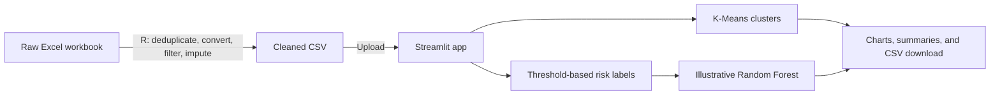

<div align="center">

# Patient Risk Modeling

### An educational vital-signs analysis and visualization app

Explore patient clusters, rule-based risk categories, feature importance, and an
illustrative single-patient estimate in an interactive Streamlit dashboard.

<a href="https://a4gnm2nuhnljly6cwnlgmz.streamlit.app/">
  
</a>

<br>

[](https://www.python.org/)
[](https://www.r-project.org/)
[](https://streamlit.io/)
[](https://github.com/RanakGit/patient-risk-model)

**[Launch the live app](https://a4gnm2nuhnljly6cwnlgmz.streamlit.app/) · [Get started](#-get-started) · [See the workflow](#-how-it-works) · [Read the safety notice](#-important-safety-and-privacy-notice)**

</div>

> **Educational use only.** This project is not a medical device, diagnostic tool,
> or clinically validated risk model. Never use its output to make decisions
> about patient care.

---

## Contents

- [Project overview](#-project-overview)
- [What you can explore](#-what-you-can-explore)
- [How it works](#-how-it-works)
- [Get started](#-get-started)
- [Project layout](#-project-layout)
- [Important safety and privacy notice](#-important-safety-and-privacy-notice)

## 🔎 Project overview

This project demonstrates a simple clinical-data workflow: clean vital-signs
records in R, explore clusters with K-Means, and display a rule-derived risk
category alongside an illustrative Random Forest model in Python.

The app is hosted on Streamlit Community Cloud and accepts a cleaned CSV through
its upload control. You can try it without installing the project locally:

<div align="center">

### [🩺 Open the Vital Signs Analyzer](https://a4gnm2nuhnljly6cwnlgmz.streamlit.app/)

*Upload a cleaned CSV to view the analysis. Do not upload identifiable or sensitive data.*

</div>

## ✨ What you can explore

| App feature | What it shows |
|---|---|
| **Dataset preview** | The first rows of the valid uploaded records |
| **Data checks** | Rows excluded because required numeric values were missing or invalid |
| **K-Means clusters** | Two exploratory groups and their mean vital signs |
| **Rule-based categories** | Counts based on the project's temperature and heart-rate thresholds |
| **Model evaluation** | A stratified holdout agreement score against labels generated by the same rule—not clinical accuracy |
| **Feature importance** | The fitted Random Forest's relative feature-importance values |
| **Example estimate** | An illustrative output for entered age, blood pressure, heart rate, and temperature |
| **CSV download** | An analyzed copy with cluster and risk-category columns |

## 🔄 How it works



The risk label is assigned by the transparent rule **`Temp > 37 °C OR
heart_rate > 85`**. The Random Forest is trained against that same rule, so it
learns to reproduce the rule; its output and feature importance are not
independent clinical evidence or proof of predictive performance.

The app's **Model accuracy** panel reports holdout agreement with these generated
rule labels, alongside a majority-class baseline and confusion matrix. This
measures rule reproduction only; it is not accuracy against independently
observed patient outcomes and must not be interpreted as clinical performance.

## 🚀 Get started

### Option 1: Try the hosted app

1. Open the **[live Vital Signs Analyzer](https://a4gnm2nuhnljly6cwnlgmz.streamlit.app/)**.
2. Upload a cleaned CSV containing `age`, `bp`, `heart_rate`, and `Temp`.
3. Review the charts and summaries, optionally enter an example patient, and download the analyzed CSV.

### Option 2: Run the app locally

Prerequisites: Python 3.12 or later, plus the R runtime and `readxl`/`dplyr` if
you need to clean the original workbook.

1. Clone the repository and enter its folder:

   ```powershell
   git clone https://github.com/RanakGit/patient-risk-model.git
   Set-Location patient-risk-model
   ```

2. (Optional) Clean the workbook using R. Place `vital signs-Dataset.xlsx` in
   this folder, install `readxl` and `dplyr` in R, then run `clean_vital_signs.R`
   from RStudio. It creates `vital_signs_clean.csv`.
3. Install Python dependencies and start Streamlit:

   ```powershell
   python -m pip install -r requirements.txt
   python -m streamlit run app.py
   ```

4. Open the local URL printed by Streamlit and upload `vital_signs_clean.csv`.

To run the batch analysis and write `Patient_Risk_Model_Output.xlsx` locally:

```powershell
python patient_risk_model.py
```

<details>
<summary><strong>CSV format and required columns</strong></summary>

The hosted app accepts `.csv` files with these numeric columns:

| Column | Used for |
|---|---|
| `age` | Clustering, model features |
| `bp` | Clustering, model features |
| `heart_rate` | Clustering, rule-based category, model features |
| `Temp` | Clustering, rule-based category, model features |

Additional columns are retained in the analysis output. Rows with missing or
non-numeric required values are excluded and the app reports how many rows were
dropped.

</details>

## 📁 Project layout

| File | Purpose |
|---|---|
| [`app.py`](app.py) | Streamlit UI, visualizations, CSV upload and download |
| [`patient_risk_model.py`](patient_risk_model.py) | Reusable analysis functions and local batch runner |
| [`clean_vital_signs.R`](clean_vital_signs.R) | R script for cleaning the source Excel workbook |
| [`requirements.txt`](requirements.txt) | Python application dependencies |
| [`.gitignore`](.gitignore) | Excludes local datasets, reports, and environment files from Git |

## ⚠️ Important safety and privacy notice

- **Not for clinical use.** The threshold is a demonstration rule, not a medical
  guideline. The model is trained on labels generated from that rule and has not
  been clinically validated.
- **Do not upload protected health information (PHI), personally identifiable
  information (PII), or other sensitive patient data.** The app is publicly
  accessible. Although uploaded data is analyzed in memory and is not
  intentionally saved by the app, this is not a guarantee of confidentiality.
- Raw workbooks, CSV datasets, and Excel outputs are excluded from this public
  repository. Keep real patient data in an appropriately authorized, secure
  environment.

---

<div align="center">

**[Launch the app](https://a4gnm2nuhnljly6cwnlgmz.streamlit.app/) · [Browse the source](https://github.com/RanakGit/patient-risk-model)**

*Created as an educational project during the Clinical Research and Data Science
Internship at the Institute of Innovations (October 2025).*

</div>
